# elDoc IDP OSS

**Turn documents into structured data with AI and human review.**

elDoc IDP OSS is the open-source edition of elDoc's AI-powered intelligent document processing system, offering a focused set of core features. Ingest documents, use AI to understand and classify them, extract structured data, and let people validate the results in a web UI before exporting them.

Try it with your own PDFs and scanned images: **upload → understand → extract → review → export CSV**.

## Application Screenshots

Explore the elDoc IDP user interface. Click any screenshot to view it in full resolution.

<p align="center">
  <a href="docs/images/ui/ui01.png">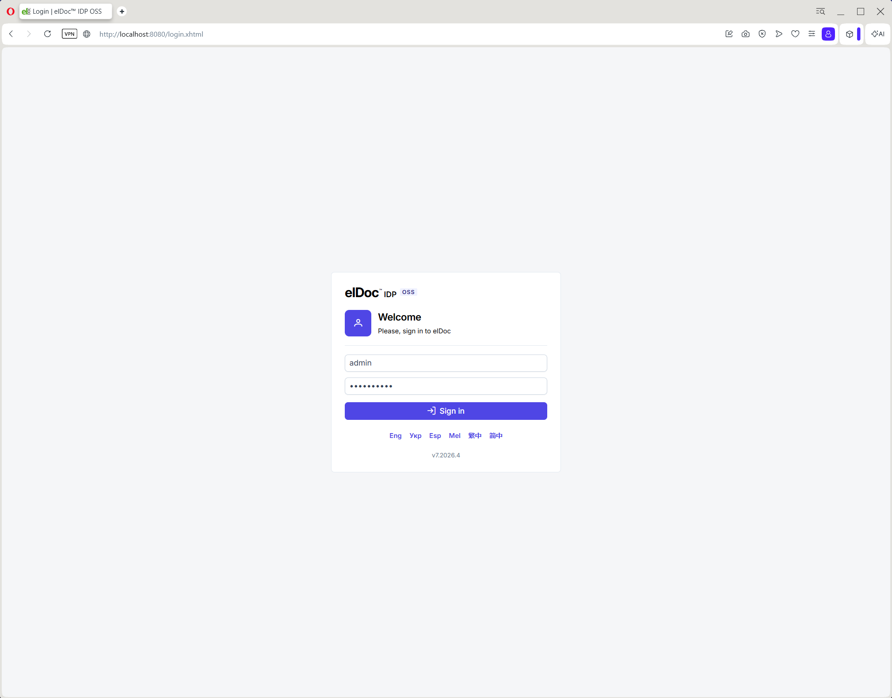</a>
  <a href="docs/images/ui/ui02.png">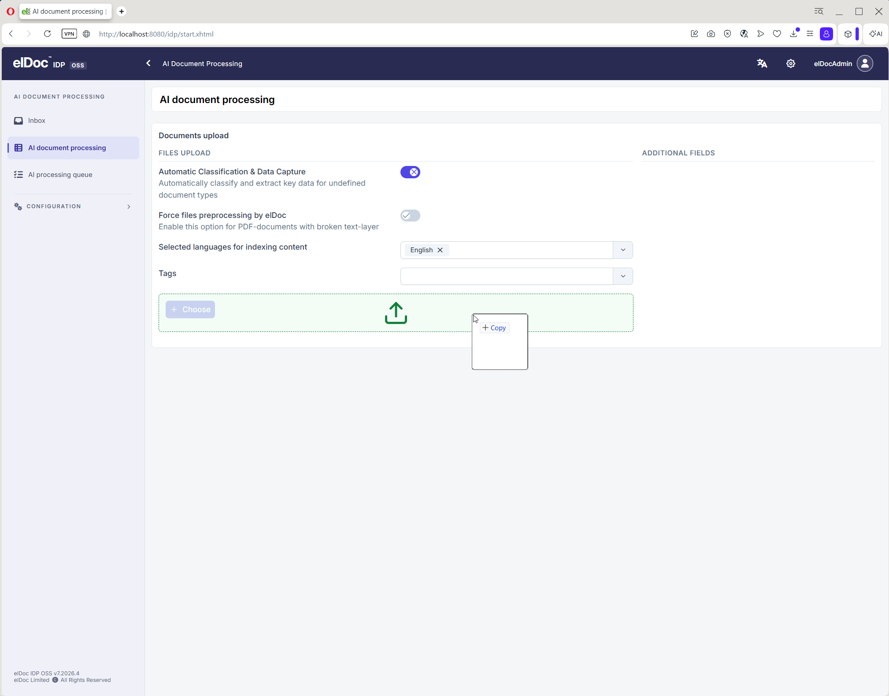</a>
  <a href="docs/images/ui/ui03.png">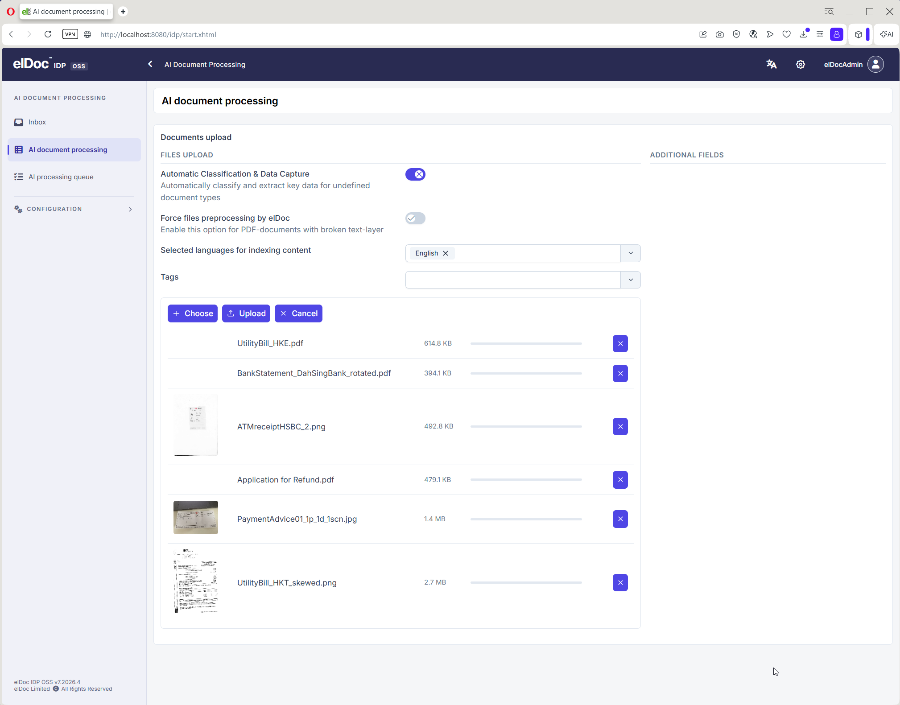</a>
</p>

<p align="center">
  <a href="docs/images/ui/ui04.png">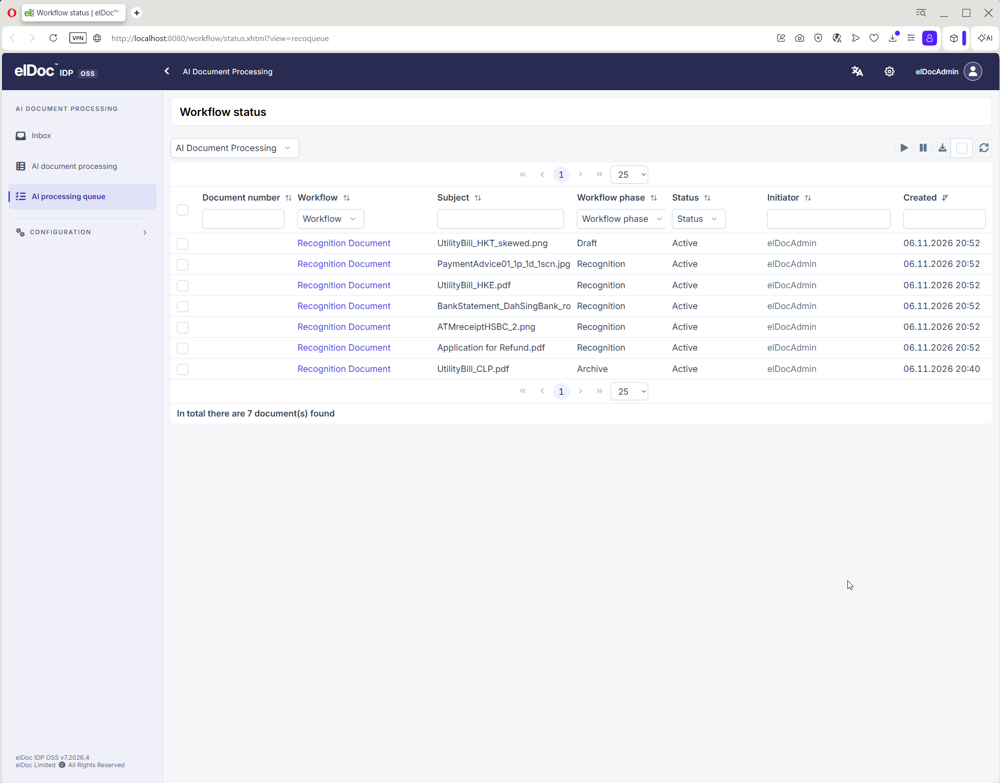</a>
  <a href="docs/images/ui/ui05.png">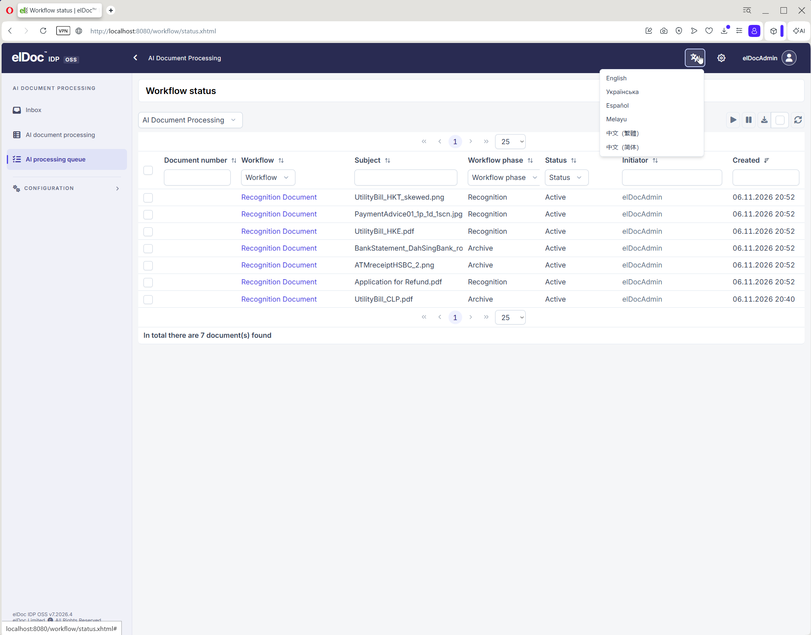</a>
  <a href="docs/images/ui/ui06.png"></a>
</p>

<p align="center">
  <a href="docs/images/ui/ui07.png">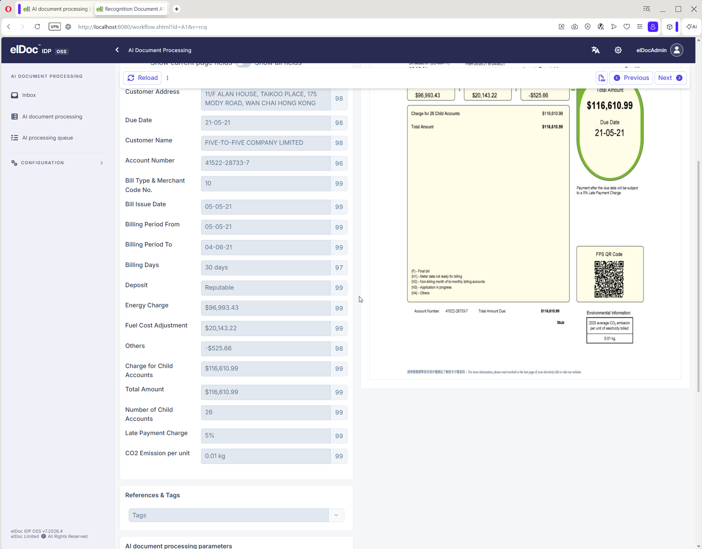</a>
  <a href="docs/images/ui/ui08.png">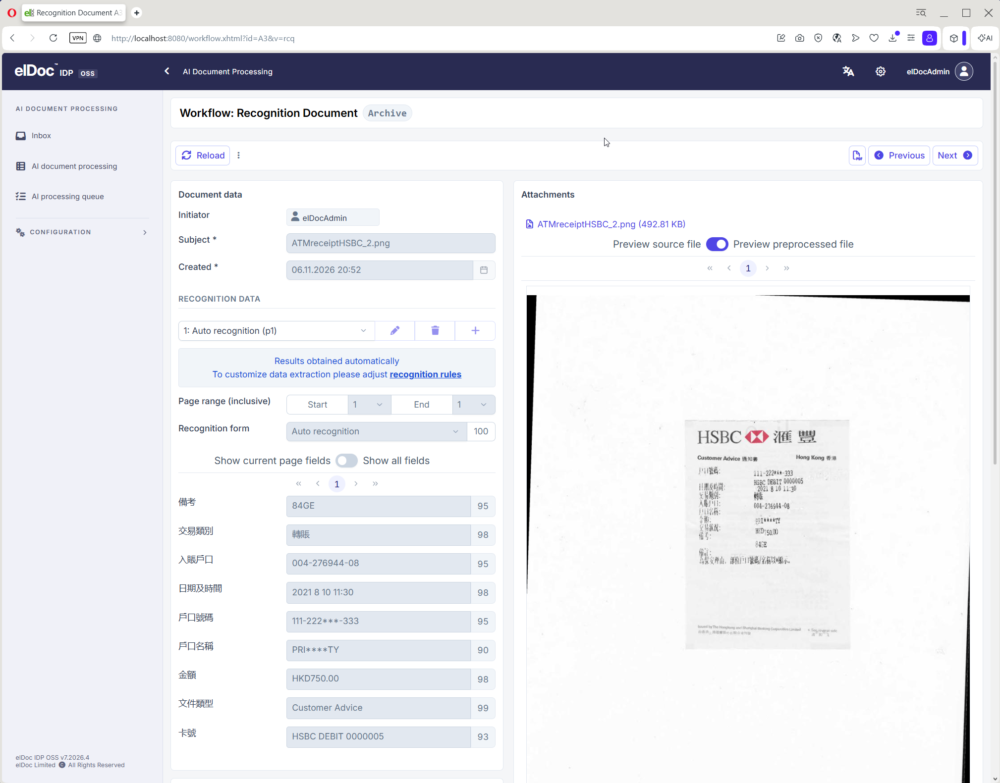</a>
  <a href="docs/images/ui/ui09.png">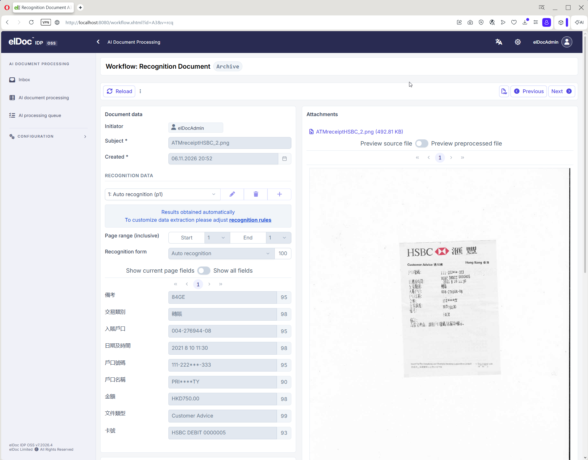</a>
</p>

<p align="center">
  <a href="docs/images/ui/ui10.png">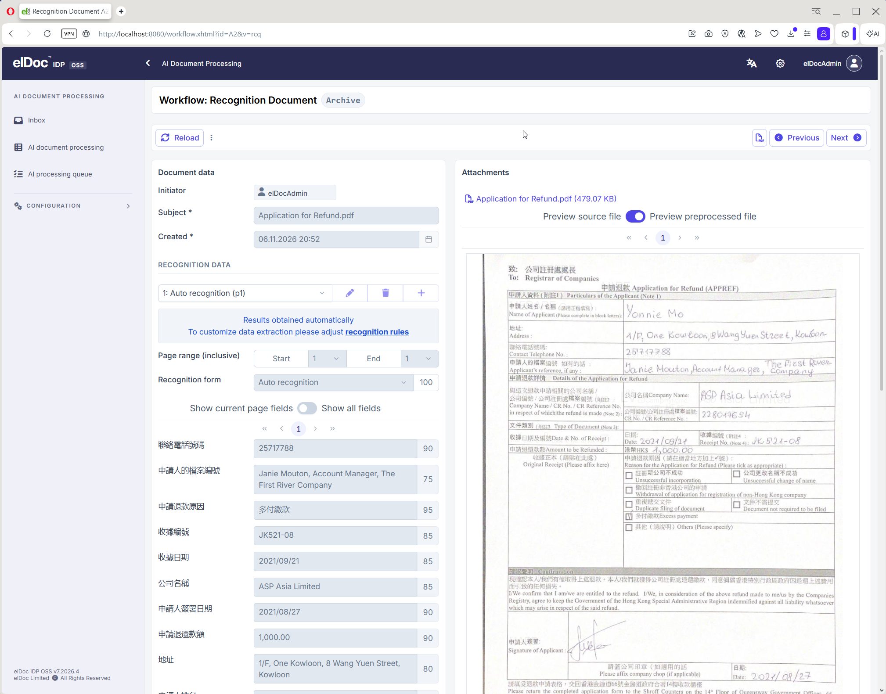</a>
  <a href="docs/images/ui/ui11.png">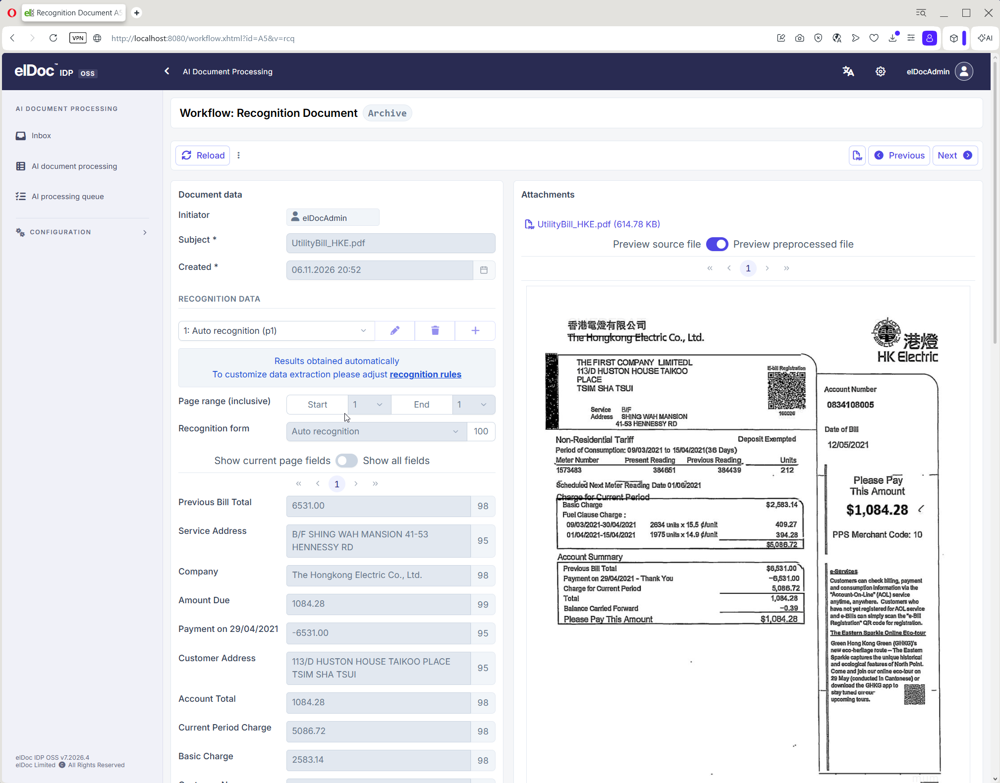</a>
  <a href="docs/images/ui/ui12.png">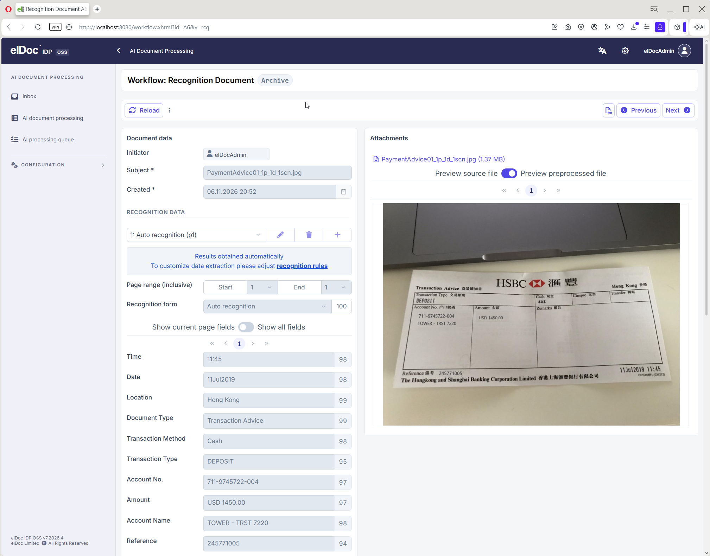</a>
</p>

<p align="center">
  <a href="docs/images/ui/ui13.png">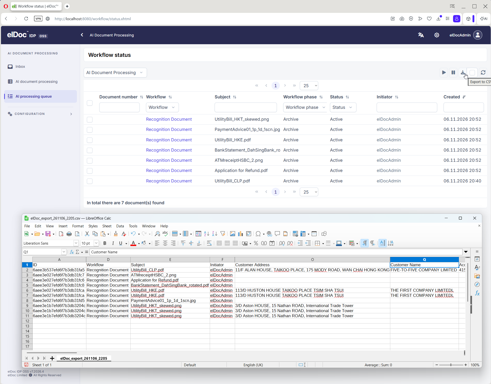</a>
</p>


## Features

- **Document ingestion:** upload documents through the web UI.
- **OCR and image processing:** recognize text and prepare scanned documents for processing.
- **PDF and image support:** process machine-generated and scanned PDFs, multiple image formats, and multipage TIFFs.
- **AI-assisted understanding:** classify documents, extract fields, and validate results with AI.
- **Human in the loop:** review and validate document results in the web UI.
- **CSV export:** download structured results through the UI. API access is available in the full version.

## Quick Start

You need **JDK 21**, network access, and an AI provider configured for tool calling and vision-language tasks. The application starts its own MongoDB for local evaluation; no separate database installation is needed.

### 1. Connect an AI provider

The default [configuration](configs/eldoc-idp-oss.conf) includes the [OpenRouter preset](configs/eldoc-idp-oss-ai.openrouter.conf). Replace both `YOUR_OPENROUTER_TOKEN` placeholders in that preset with your API token and ensure your provider account has credit. Keep tokens out of Git.

You can launch the application without an API token to explore the UI, but document processing requires a configured AI provider.

For other providers or local models, see [AI Providers / Models](#ai-providers--models).

### 2. Build and launch

Run from the repository root.

On **Linux**:

```bash
./mvnw clean verify
java '-Dai.eldoc.idp-oss.configDir=configs' '-Dai.eldoc.maintenance.password=P@ssw0rd123' -jar modules/eldoc-idp-web/target/elDoc-idp-oss-7.2026.4-server-linux.jar
```

On **Windows**:

```powershell
.\mvnw.cmd clean verify
java '-Dai.eldoc.idp-oss.configDir=configs' '-Dai.eldoc.maintenance.password=P@ssw0rd123' -jar modules/eldoc-idp-web/target/elDoc-idp-oss-7.2026.4-server-win.jar
```

For macOS, use `./mvnw clean verify` and the generated `-server-mac.jar`. See [platform requirements](#system-requirements) before building.

**Allow several minutes on first launch.** MongoDB and about 1.4 GB of Tesseract language data are downloaded and cached. HTTP 404 responses during initialization are expected; wait for `elDoc: Servlet Context ready` and the login page to become available.

### 3. Process your first document

1. Open [localhost:8080](http://localhost:8080/) and sign in as `admin` with the example password `P@ssw0rd123` set above. Choose your own password for subsequent use, or omit the password parameter to generate a password that is printed to the console at startup.
2. Optionally [configure document recognition fields](http://localhost:8080/admin/recoForms.xhtml), or use the default fully automatic processing.
3. [Upload a document](http://localhost:8080/idp/start.xhtml) and start processing.
4. Review and validate the extracted results, then export them as CSV from the UI.

## OSS vs. Full Version

elDoc IDP OSS provides the core AI document processing and human review workflow. The full version adds enterprise administration, integrations, and document collaboration capabilities.

| Capability | elDoc IDP OSS | elDoc GenAI (full version) |
| --- | --- | --- |
| Document ingestion, OCR, and PDF and image processing | Included | Included |
| Image normalization, deskewing, and rotation correction | Included | Included |
| AI classification and data extraction | Included | Included |
| Optional post-processing of extracted data | Included | Included |
| Web UI and human validation of results | Included | Included |
| CSV export through the UI | Included | Included |
| Google Cloud Vision OCR integration | Not included | Included |
| AI chat with agentic RAG | Not included | Included |
| Full-text search | Not included | Included |
| Semantic search | Not included | Included |
| LLM and integration management | Via configuration file | Via the Integrations page |
| IDP plugins | Not included | Included |
| Recognition processors (Anchor Processor, Regex Processor) | Not included | Included |
| API access | Not included | Included |
| Online document preview and editing | Not included | Included |
| User management | Not included | Included |
| Group management | Not included | Included |
| Organizational structure | Not included | Included |
| Active Directory (AD) integration | Not included | Included |
| Multitenancy | Not included | Included |

## Commercial / Enterprise

For enterprise features, commercial support, or proprietary/OEM licensing, [contact elDoc](https://eldoc.ai/). See [commercial licensing](COMMERCIAL-LICENSE.md) for details.

## Project Status

The current source version is **7.2026.4**, aligned with the full elDoc version. OSS provides the core AI document processing workflow for local evaluation and development; this version number does not imply feature parity with the full version.


## System Requirements

- JDK 21; the Maven Wrapper supplies Maven.
- Native build profiles: Windows x86-64; Linux x86-64 or ARM64; macOS x86-64 or ARM64 (macOS builds have not yet been tested). Embedded MongoDB must also support your OS and architecture.
- Network access to Maven repositories during builds, MongoDB downloads and GitHub on first launch, and your configured AI endpoint during processing.
- Disk space for downloaded OCR language data, MongoDB binaries, and your documents.
- Write access to database, binary-cache, and OCR language-data directories.
- On Linux-based systems, the embedded Bytedeco native libraries require **GLIBC 2.35 or later**. Verify the installed GLIBC version using either `ldd --version` or `getconf GNU_LIBC_VERSION` commands.

## Build from Source

Run the following command from the repository root:

On Linux and macOS, use:

```bash
./mvnw clean verify
```

On Windows:

```powershell
.\mvnw.cmd clean verify
```

The executable artifact is `modules/eldoc-idp-web/target/elDoc-idp-oss-<revision>-server-<platform>.jar`. The root `pom.xml` defines `<revision>`; `<platform>` is `win`, `linux`, or `mac`.

Maven copies the Bytedeco OpenCV/Tesseract runtime JARs into `libs/` and native classifier JARs into `libs/linux`, `libs/mac`, or `libs/win`. The Payara Micro Uber JAR includes the common JARs and the build host's native libraries. JavaCPP extracts the native binaries at startup.

**IMPORTANT:** Build on the same OS and CPU architecture where the executable will run.

## Configuration

The default file is [configs/eldoc-idp-oss.conf](configs/eldoc-idp-oss.conf). Select its directory with:

- JVM option `-Dai.eldoc.idp-oss.configDir=<directory>`, or
- Environment variable `ELDOC_IDP_OSS_CONFIG_DIR=<directory>`.

The application uses the JVM option if it is set; otherwise, it uses the environment variable. A directory specified this way must contain `eldoc-idp-oss.conf`. If the file cannot be loaded, initialization fails rather than falling back to another directory.

If no directory is specified, the application checks the `configs` folder inside the directory you launched Java from. If the file is not there, it checks the `configs` folder in the parent directory, then each parent up to the filesystem root, using the first `eldoc-idp-oss.conf` it finds. For example, launching from the repository root loads `configs/eldoc-idp-oss.conf`; launching from `modules/eldoc-idp-web` also finds that file by walking up to the repository root. If no file is found, the application uses built-in defaults.

A blank or whitespace-only value triggers this automatic search. If the JVM option is set to a blank value, the environment variable is ignored.

### AI Providers / Models

Configure models for the agent and vision-language roles before processing documents. The agent requires tool calling; the vision-language role requires image understanding. Choose models that support the required capabilities.

Sample configurations in [configs/](configs/) cover OpenRouter, AWS Bedrock, and OpenAI-compatible endpoints. Compatible local model servers can also be configured. Check endpoint, model ID, credentials, and model capabilities for each role; AWS Bedrock uses its own provider configuration.

The default configuration includes `eldoc-idp-oss-ai.openrouter.conf`. To use another preset, change the `include` directive in `eldoc-idp-oss.conf` and configure the selected file.

### OCR Module

By default, **elDoc IDP OSS** uses embedded **Tesseract OCR** for text recognition. To use a different OCR engine, configure the `IDP` section in the `eldoc-idp-oss.conf` file.

Additional OCR engines supported by elDoc IDP OSS include:

- **PaddleOCR** — Supports fully local, on-premises deployment without relying on external cloud services.
- **Vision-Language Models** — Enable AI-powered text extraction and document understanding using multimodal models.

While the embedded Tesseract OCR simplifies initial deployment and setup, more advanced OCR engines, such as **PaddleOCR**, can deliver higher recognition accuracy, particularly for complex document layouts and challenging input quality. Therefore, evaluating alternative OCR engines is recommended for production deployments where OCR accuracy is a priority.

On first launch, TessData is downloaded to the directory specified by the `ELDOC_OCR_TESSDATA_DIR` environment variable, which maps to the `idp.tessdata.path` configuration parameter.

### MongoDB

When `idposs.db.conn` (mapped to `ELDOC_MONGODB_URI` by default) is blank or unset, the application starts an anonymous, loopback-only embedded MongoDB replica set before database clients initialize.

Default storage locations:

- Database: `${java.io.tmpdir}/eldoc-idp-oss-db-data`.
- Binary cache: `${java.io.tmpdir}/eldoc-idp-oss-db-bin`.
- OCR language data: `${java.io.tmpdir}/eldoc-idp-oss-tessdata-best`.

On Windows, `${java.io.tmpdir}` normally resolves to `%TEMP%`.

| Environment variable | Purpose |
| --- | --- |
| `ELDOC_MONGODB_URI` | External MongoDB URI; disables embedded MongoDB when set |
| `ELDOC_MONGODB_USER` | Optional external MongoDB username; default authentication database: `eldoc_idposs` |
| `ELDOC_MONGODB_PASSWORD` | Optional password; supply together with the username |
| `ELDOC_EMBEDDED_MONGODB_DATA_DIR` | Embedded database directory |
| `ELDOC_EMBEDDED_MONGODB_BINARY_CACHE_DIR` | Binary download/extraction cache |

An external URI takes precedence. Authenticated and anonymous external deployments are supported. For production, use a separately managed MongoDB replica set with appropriate authentication, TLS, backups, monitoring, and availability. **The embedded fallback is intended for local development and evaluation only.**

Embedded MongoDB may remain running after the application stops. Before resetting local data, stop the application and its MongoDB process. Delete only the intended data directory; remove the binary cache only if a fresh download is needed. Override the default directories when local data must survive OS temp cleanup.

## Processing Workflow

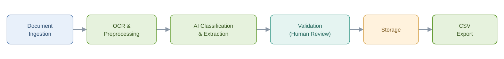

The application combines a Jakarta Faces / PrimeFaces web UI, Java processing services, MongoDB persistence, and configured AI providers, packaged with Payara Micro.

## Documentation and Support

- [Getting started](https://quickstart.eldoc.ai/ai-document-processing)
- [Recognition configuration](https://docs.eldoc.ai/latest/admin-guide/ai-document-processing-configuration)
- Bugs: use this repository's issue tracker and include reproduction steps, version, and relevant sanitized logs.
- Enterprise support: [contact elDoc](https://eldoc.ai/).

The online guides cover the broader elDoc product; some screens and features are available only in the full version. Refer to the comparison above for elDoc IDP OSS scope.

## Contributing

Bug reports, documentation improvements, and focused code contributions are welcome. Describe the problem and how to reproduce or verify your change. Contributions are subject to the [elDoc Contributor License Agreement](CLA.md).

## Acknowledgements

First and foremost, thank you for your interest in **elDoc IDP OSS**. We sincerely appreciate your support and contributions to the open-source community.

On behalf of the entire elDoc team, we would like to express our gratitude to the open-source community, whose dedication, innovation, and collaborative spirit have made projects like ours possible.

### Special Thanks

We would like to extend our **special thanks to three foundational open-source projects** that played a crucial role in bringing elDoc IDP to life back in 2019–2020:

- **[TwelveMonkeys ImageIO](https://github.com/haraldk/TwelveMonkeys)**
- **[Bytedeco](https://github.com/bytedeco)**
- **[Apache PDFBox](https://github.com/apache/pdfbox)**

These three projects formed the essential technological pillars upon which the early versions of elDoc IDP were built. Without them, bringing our vision to life at that time would not have been possible.

### Our Appreciation to the Open-Source Community

We are equally grateful to the many other open-source projects and their contributors whose work continues to power and enrich elDoc IDP OSS, including **LangChain4j**, **Tesseract**, **OpenCV**, **PrimeFaces**, **Apache Shiro**, **Payara**, **MongoDB**, and many others.

To all the developers, maintainers, and contributors behind these projects: **thank you for making open-source innovation possible.**

Your work has been instrumental in our journey, and we are proud to be part of this community.

See [third-party notices](THIRD_PARTY_NOTICES.md) for license information.

## Licensing

elDoc IDP OSS is dual-licensed:

- **GNU Affero General Public License Version 3 only (`AGPL-3.0-only`)**: see [LICENSE](LICENSE). Commercial use is permitted under the AGPL when its terms are met.
- **Separate commercial licensing** from elDoc Limited: see [COMMERCIAL-LICENSE.md](COMMERCIAL-LICENSE.md).

Third-party components remain subject to their respective licenses. See [THIRD_PARTY_NOTICES.md](THIRD_PARTY_NOTICES.md) and the accompanying license materials.
